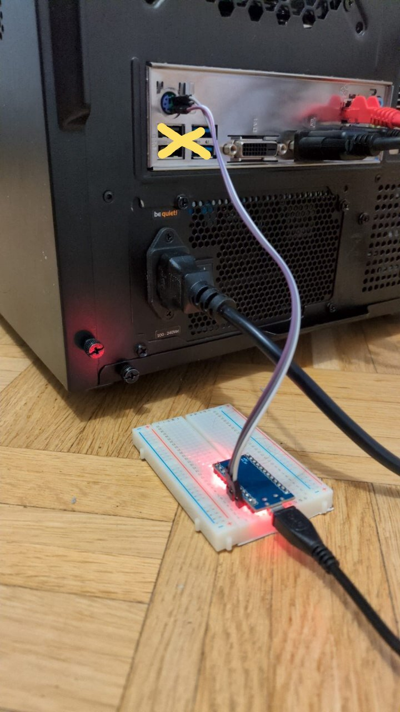

# pro-micro-to-ps2

> [!WARNING]
> Every line in this repo is ⚡electrovibe⚡-coded: firmware, terminal client,
> docs. Read it before you trust it with your hardware.

A SparkFun Pro Micro (ATmega32U4, 5 V/16 MHz) posing as a PS/2 keyboard,
typed into from a Linux terminal.

**Why.** A PC whose BIOS ignores USB keyboards (its USB controller is dead)
still has a PS/2 port, and no PS/2 keyboard is at hand. A Pro Micro and
three wires are.

**How.** `ps2term` puts the terminal in raw mode, turns each key into PS/2
scan code set 2 bytes and writes them to the board over USB serial. The
firmware puts them on the wire with [ps2dev](https://github.com/Harvie/ps2dev)
and answers the host's commands (reset, identify, LEDs, typematic, scan code
set) itself. The board runs from USB, not from the PC. See
[docs/schematic.png](docs/schematic.png) (schemdraw, `src/schematic`),
[docs/wiring.png](docs/wiring.png) (d2), `.svg` next to both, and the
breadboard in [docs/bench.fzz](docs/bench.fzz) (Fritzing, `fizzel` opens it;
generated by `src/fritzing/gen.py` with mcubench.fritzing from
[mcu-bench](https://github.com/0x0lor1n/mcu-bench), net-checked and linted in
`nix flake check`).

The setup at the back of the PC, dead USB ports crossed out:

<table><tr>
<td></td>
</tr></table>

| Pro Micro | PS/2 socket (mini-DIN-6) |
|---|---|
| D2 | pin 5 (CLOCK) |
| D3 | pin 1 (DATA) |
| GND | pin 3 (GND) |
| — | pin 4 (+5 V): leave unconnected |

## Wire protocol

USB side is a byte pipe at 115200: every byte from the host computer goes
to PS/2 verbatim. A byte the PC refuses for 1 s (line inhibited) is
dropped. What comes back on USB is one line per event:

| line | meaning |
|---|---|
| `H xx` | command byte from the PC (`FF` reset, `F2` identify, `ED` LEDs, ...) |
| `A xx` | argument of the previous `ED`/`F3`/`F0` |
| `! drop xx` | byte `xx` not delivered within 1 s |

Replies to the PC: `FF` → `FA AA`, `F2` → `FA AB 83`, `EE` → `EE`,
`F0 00` → `FA FA 02`, any other command → `FA`.

`ps2term` prints these lines and adds two keys: Ctrl-B toggles repeated
Del (to get into the BIOS setup), Ctrl-] quits.

## Install

Nix with flakes enabled, direnv (`use flake` in `.envrc`). `nix develop`
prints the available commands and installs the git hooks (lefthook.yml):
linters and formatters on commit, `nix flake check` on push.

Without cloning:

    nix run github:0x0lor1n/pro-micro-to-ps2#flash -- /dev/ttyACM0
    nix run github:0x0lor1n/pro-micro-to-ps2 -- /dev/ttyACM0

The flasher does the 1200 bps touch itself; RST to GND only when the board
has no working sketch, and it says so. `/dev/ttyACM*` is `root:dialout`:
join `dialout` rather than running nix under sudo.

## License

MIT, see [LICENSE](LICENSE). The vendor documents in `docs/schemas/` keep
their own terms (see the README next to each).
